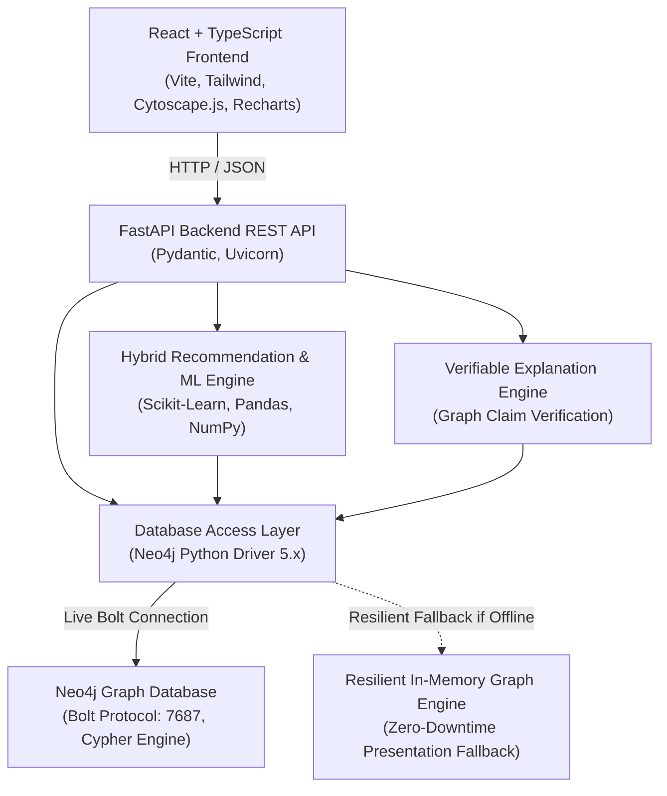

# CineGraph: Technical Architecture Overview

## 1. Executive Summary
**CineGraph** is an academic DBMS and Machine Learning platform engineered around **Neo4j** as its central graph database. The system models complex cinema relationships (users, movies, cast, directors, genres, studios, awards, and reviews) as a directed property graph. Recommendations are computed by a hybrid recommendation pipeline fusing collaborative filtering, content-based TF-IDF with structured metadata similarity, graph topology traversals via Cypher, and popularity baselines.

---

## 2. System Architecture Diagram

---

## 3. Layer Breakdown

### Layer 1: Presentation (React + TypeScript)
- **Framework**: Vite + React 18 with TypeScript.
- **Styling**: Tailwind CSS tailored with a dark cinematic aesthetic (glassmorphism, radial lighting, rich gold/crimson/emerald accents).
- **Graph Visualization**: Cytoscape.js with force-directed layouts, dynamic node expansion, and animated multi-hop query traversal walkthroughs.
- **Charts & Metrics**: Recharts for rating distributions, evaluation bar charts, and score breakdown radar/donut visualizations.

### Layer 2: API & Application Logic (FastAPI)
- **Runtime**: Python 3.11 with FastAPI and Uvicorn.
- **Schemas**: Strict Pydantic models validating all requests and responses.
- **Security**: Password hashing via Bcrypt; token-safe architecture where password hashes are strictly redacted from all graph and API queries.

### Layer 3: Machine Learning & Recommendation Engine
- **Collaborative Filtering**: User-based collaborative filtering with mean-centered user rating vectors ($r_{u, i} - \bar{r}_u$) and Pearson/Cosine user similarity.
- **Content-Based Filtering**: TF-IDF cosine similarity on film synopses coupled with structured multi-attribute similarity (genres Jaccard, director identity, cast overlap, language match, release year decay).
- **Graph Topology Signals**: Cypher traversal queries uncovering shared creative DNA (directors, co-stars, genre clusters) and peer recommendation paths.
- **Hybrid Fusion**: Min-Max normalized score combining 4 tunable components:
  $$\text{Score}(u, i) = w_{\text{collab}} S_{\text{collab}} + w_{\text{content}} S_{\text{content}} + w_{\text{graph}} S_{\text{graph}} + w_{\text{pop}} S_{\text{pop}}$$
- **Cold-Start Handling**: Graceful degradation for cold-start users (e.g. `u15`) to genre onboarding preferences, cast/director metadata, and popularity without NaN or crashes.
- **Leakage-Free Evaluation**: 5-seed stratified hold-out split strictly isolating test ratings from similarity matrices and graph anchor sets.

### Layer 4: Graph Database (Neo4j & Cypher)
- **Primary DBMS**: Neo4j Community Edition 5.x.
- **Protocol**: Bolt (`bolt://localhost:7687` or `neo4j+s://` via Aura).
- **Constraints & Indexes**: Uniqueness constraints on all primary entity keys; Range/B-Tree indexes on frequent search and filter predicates (`Movie.title`, `Movie.release_year`, etc.).
- **Transaction Safety**: Atomic write transactions using `MERGE` semantics for ratings, watch progress, and watchlists to ensure idempotency.
